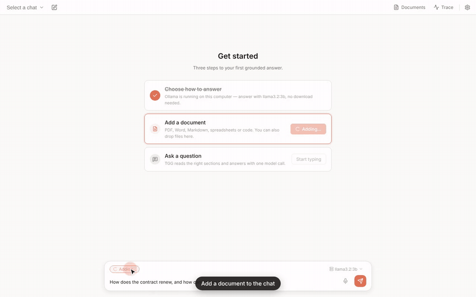
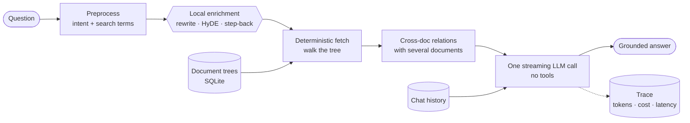
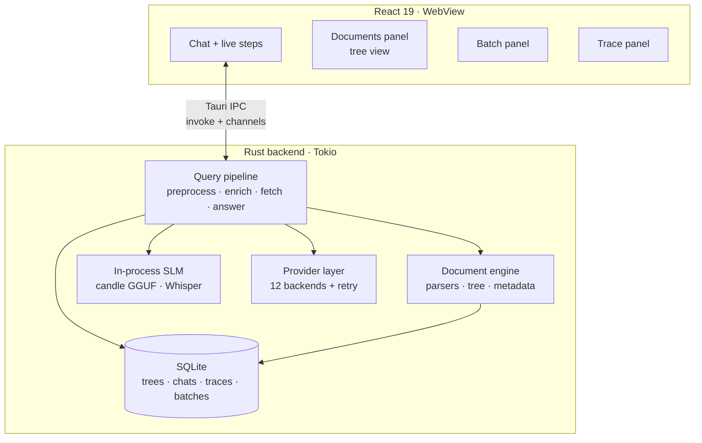

<div align="center">

# TGG — Tree-Grounded Generation

**Ask questions about your documents — without embeddings, vector databases, or chunking.**

Documents are parsed into trees. A deterministic fetcher walks the tree to the right sections, and one streaming LLM call writes an answer grounded in what it read. Every step is shown as it happens.

[](https://github.com/Kedhareswer/vectorless-rag/actions/workflows/ci.yml)
[](https://v2.tauri.app)
[](https://react.dev)
[](https://www.rust-lang.org)
[](https://sqlite.org)
[](LICENSE)



<sub>Add a document, ask a question — the pipeline steps appear live, then the answer cites the sections it came from (§9.1, §9.4).</sub>

</div>

---

## Why not regular RAG?

Traditional RAG splits documents into fixed-size chunks, embeds them, and retrieves the top-k by cosine similarity. What gets thrown away is exactly what makes a document readable: its structure.

<p align="center">
  
</p>

| What chunking destroys | Effect on the answer |
| :--- | :--- |
| Heading hierarchy | A paragraph floats with no parent section |
| Table structure | Rows and columns collapse into one string |
| Cross-references | "See §3.3" points nowhere |
| Document boundaries | Fragments from unrelated documents mix |
| Code structure | Functions detach from their class and module |

TGG keeps the tree and reads it the way a person would:

| Stage | Traditional RAG | TGG |
| :--- | :--- | :--- |
| **Ingest** | Split into fixed-size chunks | Parse into a tree of typed nodes |
| **Index** | Embed every chunk into a vector DB | Store the tree in local SQLite — no embeddings |
| **Query** | Embed the query, cosine top-k | Enrich the query (rewrite, HyDE, step-back) |
| **Retrieve** | Top-k fragments by similarity | Deterministic walk: code picks nodes by intent + terms |
| **Context** | Decontextualized fragments | Whole sections, in document order, with headings |
| **Answer** | LLM over shuffled fragments | One streaming call — no tools, no agent loop |
| **Explain** | No record of why a chunk was picked | Full trace of every step, with tokens and cost |

---

## How it works



1. **Preprocess** — a fast heuristic classifies intent (summarize, factual, comparison, list…) and extracts search terms. No model call.
2. **Enrich** — a small model running *inside the app* rewrites the query, writes a hypothetical answer (HyDE) and a broader step-back question, harvesting extra terms that match the document's vocabulary. Free and offline; skipped if no local model is installed.
3. **Fetch** — plain code decides what to read: expand top-level sections to summarize, follow matching nodes for facts, pull tables and lists for extraction. Capped at 40,000 characters.
4. **Relate** — with several documents in a chat, shared entities and overlapping topics are linked and handed to the model.
5. **Answer** — one streaming call to the model you chose. **The model never gets tools and never loops.** It reads what was fetched and answers.
6. **Trace** — every step is saved with its tokens, cost and latency.

### The Universal Document Tree

Every format parses into the same schema, so the fetcher never needs to know where a document came from:

```rust
Node {
    id:        String,
    node_type: NodeType,   // Section | Paragraph | Table | TableRow | ListItem | CodeBlock | Image | …
    content:   String,
    metadata:  Metadata,   // page, word count, summary, entities, topics, heading level …
    children:  Vec<Node>,
    relations: Vec<Relation>,
}
```

| Format | Extensions | Parsed structure |
| :--- | :--- | :--- |
| PDF | `.pdf` | Layout-aware via PDFium (LiteParse): headings, paragraphs, lists, tables, code — with page numbers |
| Word | `.docx` | Heading styles → paragraphs → nested tables |
| Markdown | `.md` `.markdown` | Full GFM — headings, code blocks, lists, images, links |
| Spreadsheet | `.xlsx` `.xls` `.ods` | Sheets → rows → typed cells |
| CSV | `.csv` | Header row → data rows (up to 500 per file) |
| Source code | 23 languages | Modules → classes → functions → blocks |
| Plain text | `.txt` `.log` | Paragraphs split on blank lines |

---

## Features

**Grounded, explainable answers** — every step (rewrite, HyDE, step-back, search, read, answer) appears live under your question and folds away when done. The Trace panel shows tokens, latency and cost per step.

**Documents belong to chats** — each conversation has its own documents. The same file can sit in several chats without being stored twice.

**Multi-document reasoning** — shared entities and topic overlap between documents are discovered automatically and given to the model.

**Bring any model** — answer with a cloud provider, a model already running in Ollama or LM Studio (detected automatically), or the built-in offline model.

**Fully offline mode** — one ~700 MB download (Liquid LFM2.5-1.2B) handles query enrichment, document summaries *and* answers, on the CPU, with nothing leaving your machine.

**Prompt caching** — the fetched document content is marked as a cache breakpoint for Anthropic models, so follow-up questions in a chat re-read it at a tenth of the input price. Cache reads and writes are costed separately in the trace.

**Prompt-injection guardrails** — document text is treated as untrusted data: it is fenced in the prompt, forged fence markers are stripped, and the model is told that instructions inside a document are content to report on, not commands to follow.

**Batch work**
- *Add many documents at once* — multi-select in the file picker or drop several files onto the window; they are parsed one after another with progress, and one bad file doesn't stop the rest.
- *Re-enrich all* — regenerate summaries, entities and topics for every document in a chat in one pass, with the model loaded once.
- *Batch questions* — submit up to 50 questions over a chat's documents through the Anthropic Message Batches API at half the price. Each question runs the same enrich → fetch pipeline; answers arrive within 24 hours (usually minutes).

**Offline dictation** — the mic button transcribes speech with Whisper (tiny.en, ~42 MB) entirely on-device.

**Interactive tree view** — explore each document's structure, filter nodes, and inspect metadata.

**Local-first** — trees, chats and traces live in SQLite in your app-data folder. API keys go in the OS keychain. No telemetry.

---

## Models

All providers share one Rust `LLMProvider` trait with streaming, automatic retry on transient errors, and per-model cost tracking.

| Provider | Models | Notes |
| :--- | :--- | :--- |
| **Anthropic** | Claude Sonnet, Opus, Haiku | Native SSE streaming · prompt caching · Batch API |
| **OpenAI** | GPT-4o, GPT-4.1, o1, o3, o4-mini | |
| **Google AI Studio** | Gemini 2.5 Pro, 2.5 Flash | Vision-capable |
| **Groq** | Llama 3.3 70B, Mixtral | Fast inference |
| **DeepSeek** | DeepSeek Chat, DeepSeek Reasoner | |
| **xAI** | Grok 3, Grok 3 Mini | |
| **Qwen** | Qwen Max, Plus, Turbo | |
| **OpenRouter** | 100+ models | One key for many vendors |
| **AgentRouter** | GPT-5, DeepSeek, GLM | Automatic routing |
| **Ollama** | Any local model | Detected automatically; 16k context requested |
| **LM Studio** | Any loaded model | Detected automatically; no API key |
| **Local (offline)** | LFM2.5-1.2B-Instruct | Runs inside the app; cost is always 0 |

---

## Architecture



| Layer | Technology |
| :--- | :--- |
| Desktop shell | Tauri v2 |
| Frontend | React 19, TypeScript 7, Vite 8, Zustand 5, CSS Modules |
| Backend | Rust (edition 2024), Tokio |
| Local inference | candle (GGUF LFM2.5 / Qwen2 / Llama, Whisper) |
| PDF | LiteParse + PDFium, pdf-extract fallback |
| Storage | SQLite via `rusqlite` (WAL), OS keychain via `keyring` |
| Markdown | `react-markdown`, `remark-gfm`, `rehype-sanitize` |

---

## Getting started

### Prerequisites

- [Node.js](https://nodejs.org/) 24 LTS (or 22.22.2+)
- [Rust](https://rustup.rs/) stable (1.95+)
- Platform build tools — see [Tauri v2 prerequisites](https://v2.tauri.app/start/prerequisites/). On Windows: Visual Studio Build Tools with the **C++ workload**, and the WebView2 runtime (preinstalled on Windows 11).

### Run it

```bash
npm install
npm run tauri dev
```

The first build compiles ~700 crates and downloads PDFium, so give it several minutes. Later builds are incremental.

### Build an installer

```bash
npm run tauri build
```

Output lands in `src-tauri/target/release/bundle/` — `.msi` / `.exe` on Windows, `.dmg` on macOS, `.deb` / `.AppImage` on Linux.

### First steps

1. **Pick how to answer.** The setup checklist offers a model already in Ollama or LM Studio, the built-in offline model, or a cloud API key.
2. **Add documents** with **+ Add** in the message box, or drop files onto the window. Select several at once to add them in one go.
3. **Ask.** Watch the steps, read the answer, open **Trace** to see what it cost.

### Keyboard shortcuts

`Ctrl` on Windows/Linux, `⌘` on macOS.

| Shortcut | Action |
| :--- | :--- |
| `Ctrl+N` | New chat |
| `Ctrl+K` | Switch chat |
| `Ctrl+D` | Documents panel |
| `Ctrl+J` | Trace panel |
| `Ctrl+B` | Batch questions panel |
| `Ctrl+,` | Settings |
| `/` | Focus the message box |

### Tests

```bash
npm test                         # frontend (Vitest)
npx tsc --noEmit                 # type check
cd src-tauri && cargo test --lib # backend
```

---

## Known limitations

- **Scanned PDFs** — image-only pages have no text layer. An ONNX OCR backend is wired in, but it needs an ONNX Runtime library built for the dynamic MSVC runtime, which is not bundled yet; until then such pages fall back to a "no extractable text" placeholder.
- **Images in documents** are extracted and placed in the tree, but their content is not analyzed.
- **Batch questions** use the Anthropic Message Batches API only. Batched questions are answered independently, without chat history.
- **Prompt caching** applies to Anthropic models. Caching rewards a repeated prefix, so it pays off on follow-ups that fetch the same sections, not across unrelated questions.
- **The offline model** is slower and simpler than large cloud models. The 230M variant (~150 MB) is offered for low-memory machines, for enrichment only.
- **Dictation** targets Windows release builds; macOS and Linux microphone access is not configured.

---

## License

[MIT](LICENSE)
